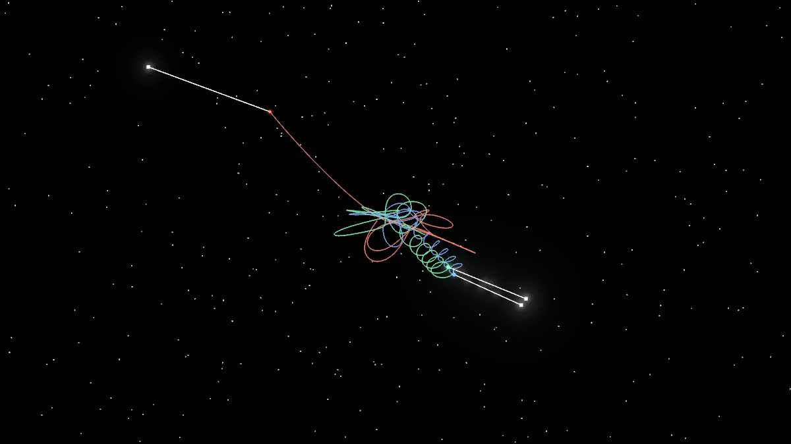
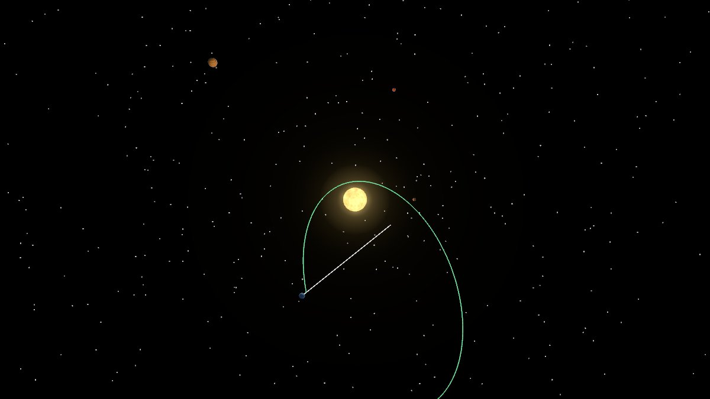
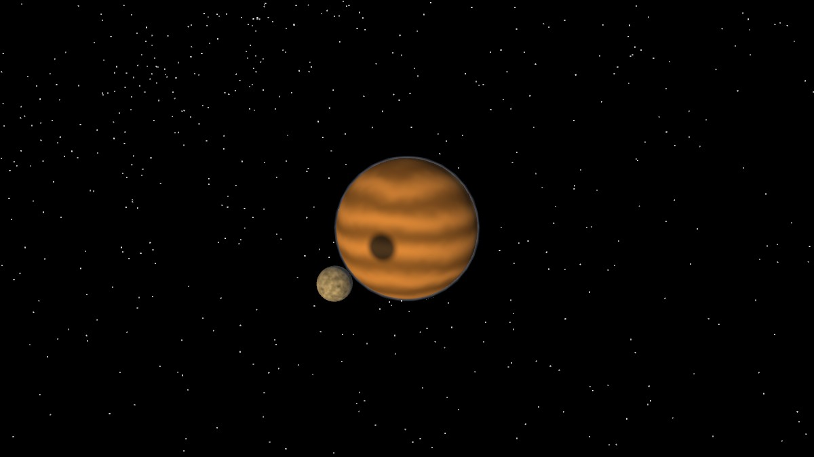
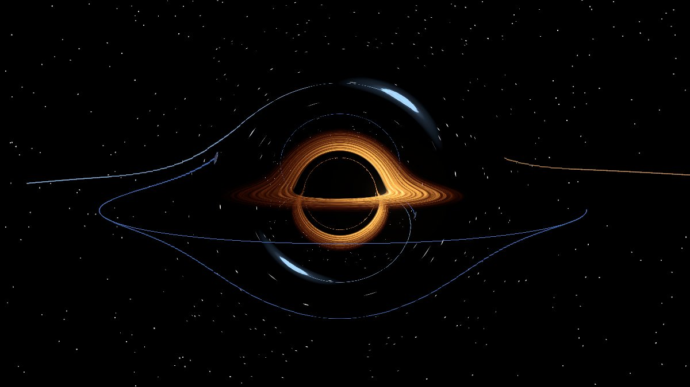

# ORBITAL

Interactive 3D N-body gravity laboratory. Runs entirely locally; no services, no paid APIs.

## Install and run

```bash
npm install
npm run dev     # open the printed localhost URL
npm test        # physics unit tests
npm run build   # typecheck + production build
```

Needs Node 20+ (developed on Node 26).

## Architecture

```
src/physics/engine.ts    Pure N-body engine. No DOM, React or three.js. Unit-tested.
src/physics/presets.ts   Body-type table, circular-orbit helper, experiment presets.
src/physics/worker.ts    Web Worker entry: runs the same engine loop off the main thread.
src/sim.ts               The mutable world, Zustand store, 4 Hz chart series, rewind, save/load.
src/storage.ts           IndexedDB wrapper for saved setups.
src/Viewport.tsx         three.js scene and the frame loop (step physics, sync meshes, render).
src/textures.ts          Procedural surface maps (canvas noise) and the atmosphere rim shader.
src/blackhole.ts         Ray-traced black-hole shader: light paths, accretion disk, lensing.
src/eclipse.ts           Planet shader with analytic eclipse shadows (sphere-on-disk occlusion).
src/Panel.tsx            Controls, charts, body list, inspector, saved setups.
```

Rules that keep it fast and honest:

- **Physics never touches React.** The world is a plain mutable object. The frame loop steps it
  and writes mesh positions directly. React only re-renders from a stats snapshot at 4 Hz.
- **The engine is pure.** Everything in `physics/` runs in Node, so it is tested without a browser
  and can move into a Web Worker unchanged.
- **No physics library.** Direct pairwise summation is about 60 lines and is exact for the force
  law. A library would add nothing below a few thousand bodies.
- **Physics can run in a Web Worker** (Simulation → Physics thread). Auto moves it there from
  250 bodies. See "Performance" below for what that buys and what it costs.

## Performance

The main thread and the worker call the same `run()` loop, so a run gives bit-for-bit the same
trajectory on either (tested). The worker is pipelined: while it computes the next frame the
main thread renders the last finished one, with at most one job in flight. Every change made
outside the integrator (inspector edits, rewind, launches, twin start/stop, preset or save loads,
renames) bumps a version number, and a worker result computed from an older version is thrown
away rather than allowed to overwrite the change.

Measured with the generator preset (6 planets plus asteroids), 10 steps per frame, bloom on, on
an Intel Arc integrated-GPU laptop with the app window **in the background**, which probably
penalises the worker thread:

| Bodies | Frame time, main → worker | Simulated time per second, main → worker |
|---|---|---|
| 159 | 8.8 → 3.5 ms | 2.0 → 2.4 |
| 309 | 16.8 → 5.6 ms | 1.2 → 0.8 |
| 609 | 63 → 11 ms | 0.52 → 0.27 |
| 1009 | 158 → 20 ms | 0.23 → 0.09 |

So the worker keeps the view smooth (camera, panel, drag) at every size, but above ~300 bodies
the simulation itself advanced more slowly in it, because the same code ran 2–3x slower on the
worker thread in this measurement. Auto switches at 250 bodies, where the main thread stops holding 60 fps.
Pick "Main thread" if you care more about simulated time than smoothness. The force sum is
O(n²); a tree code (Barnes–Hut) would be the next step for thousands of bodies, and is not
implemented.

## Physics

Units are dimensionless with G = 1 by default. Nothing is in SI.

**Force.** Newtonian gravity with Plummer softening ε:

    a_i = Σ_j G m_j (r_j − r_i) / (|r_j − r_i|² + ε²)^(3/2)

Softening removes the singularity at r → 0 so close encounters do not blow up, at the cost of
weakening gravity at separations comparable to ε. Set ε = 0 for the exact inverse-square law.
The potential energy uses the same softened form, so the reported total energy is the quantity
the integrator is actually supposed to conserve.

**Integrators.**

| | Order | Symplectic | Energy behaviour |
|---|---|---|---|
| Velocity Verlet (default) | 2 | yes | bounded oscillation, no secular drift |
| Explicit Euler | 1 | no | grows steadily; orbits spiral outward |

Measured on the solar-system preset over 130 time units at dt = 0.005: Verlet relative energy
error about 2e-9, Euler about 1e-4.

**Collisions.** Three modes, chosen under Simulation. Each preset sets its own mode on load
(merge unless noted).

- **Merge (inelastic):** overlapping spheres become one. Mass, linear momentum and volume are
  conserved. Kinetic energy is not (a real merger turns it into heat), so the energy-error
  baseline resets after every merge.
- **Bounce (elastic):** an impulse along the line of centres, applied only while the bodies are
  approaching. Momentum and kinetic energy are conserved. Bodies are rigid smooth spheres: no
  spin, friction, fragmentation or deformation.
- **Off:** bodies pass through each other; gravity is still softened by ε.

**Known limits. Read before trusting a result.**

- Fixed time step. A close flyby needs a smaller dt than a wide orbit; watch the energy error.
- The app warns when energy error exceeds 1% and halts on a non-finite state. Below 1% the
  trajectory can still be wrong in phase; in chaotic systems any error grows exponentially,
  so long three-body runs are qualitatively, not quantitatively, correct.
- Collisions are checked once per step, so very fast small bodies can tunnel through each other.
- Newtonian only: no relativity, tides, or radiation pressure. Bodies are point masses for gravity.
- "Add body" uses the two-body circular velocity around the heaviest body; in a multi-body
  system that orbit is only approximately circular.

## Experiments to try

1. **Integrator comparison.** Solar system, switch to Euler, watch the energy-error chart climb
   and the inner orbit widen. Switch back to Verlet and press Reset.
2. **Time-step stability.** Raise dt to 0.05, then 0.2. The innermost planet fails first.
3. **Three-body figure-8.** Select a star, pause, change `vx` by 1%, resume. The choreography
   breaks up: sensitive dependence on initial conditions.
4. **Planet eater.** Solar system, add a gas giant. It often captures and merges with a rocky planet.
5. **Change G.** Halve G in the solar system; every orbit becomes unbound or highly eccentric.
6. **Slingshot.** Load it, select Probe, watch Speed climb during the flyby near t = 19. Then
   rewind to the start, change Jove's mass or the probe's velocity, and resume to compare.
7. **Rogue planet.** Let it pass, then drag Rewind back and change the rogue's mass.
8. **Unstable system.** Three giants inside each other's Hill spheres merge or eject within
   about 100 time units. Rewind and nudge one velocity: the outcome changes.
9. **Chaos.** Load "Three-body chaos (Pythagorean)", open Labs → Chaos lab, set ε to 1e-9,
   start a twin run, and set the chart to "Twin runs". The line climbs about 11 orders of
   magnitude in 60 time units, and the white twin ends in a different configuration.
10. **Bounce vs merge.** Unstable system with Collisions on Bounce: the giants scatter instead of
    merging, and the energy error stays flat because bounces conserve kinetic energy.
11. **Make your own slingshot.** Solar system, pause, then Shift-drag outward from Terra towards
    Jove's path. Adjust until the green predicted path passes close to Jove, release, resume.
    Chart "Selected: speed relative to reference" and watch for the jump at the encounter.
12. **Generated systems.** Random system, set max eccentricity to 0.4 and tilt to 30: orbits
    become eccentric and inclined, yet the planets are spaced widely enough that in a check of
    10 seeds none was lost within 300 time units. Note a seed you like; it always rebuilds the same.

## Labs



**Chaos lab (twin run).** A second copy of the system runs alongside the first with one velocity
nudged by a relative ε (absolute, if that body is at rest). White dots mark the twin's bodies and
white lines join each body to its twin. The "Twin runs" chart plots log₁₀ of the root-sum-square
position difference, so a straight rising line means exponential divergence. The twin is
dropped by rewind, reset, preset changes and loads; edits to the main run after starting are not
copied to it. It doubles the physics cost.

What it shows, measured: in the Pythagorean preset a 1e-9 nudge reaches a gap of about 60 length
units by t = 60. In the other presets divergence is much slower over the same time, growing only
10–1000-fold, because their orbits are regular or because mergers end the chaotic phase.
Both copies use the same integrator and step, so what diverges is the numerical solution's
sensitivity to its start, which is the point of the lab. Neither copy is an exact solution of
the true Pythagorean problem. Its real close encounters are far tighter than a fixed step can
resolve, which is why that preset raises softening to 0.3 and turns collisions off.

**Probe launcher.** Fires a 10⁻⁶-mass probe from just above the selected body's surface at a
chosen speed relative to that body and a heading in the orbital plane (0° along its motion
relative to the reference body, 180° against it).



**Drag-to-launch.** Shift-drag from any body in the view. The white arrow, lying in that body's
horizontal plane, is the launch velocity *relative to the body* (0.2 speed per scene unit of
arrow); the label shows the speed. The probe's actual path also includes the body's own orbital
velocity, which is why the green predicted path can start off at an angle to the arrow.
Release to launch, Esc to cancel. A plain drag still orbits the camera.

The predicted path integrates a throwaway copy of the system at 4× the current dt with no
collisions, ignores bodies lighter than 10⁻⁵ of the heaviest, and is not drawn above 40
remaining bodies. It is a guide that agrees closely with the real run at first (tested to
within 0.5 units after 160 steps) and drifts after close encounters.

**System generator.** One star, planets on geometrically spaced orbits (rocky inner, mostly gas
giants outer), moons placed inside each giant's Hill sphere, and an optional asteroid belt.
Seed, planet count (1–12), maximum eccentricity (0–0.8, each body starts at pericentre),
maximum tilt (0–45°) and asteroid count (0–300) are adjustable. Changing a control rebuilds the
system. Placement avoids overlapping bodies, but nothing guarantees long-term stability.

## Rewind

One snapshot of every body is stored every 10 frames, up to 600 (about 100 s of viewing).
Dragging the Rewind slider pauses and restores that state exactly, including bodies that later
merged. This is replay of recorded states, not reverse integration. Resuming from the past
discards the later recording; with unchanged settings the replay is bit-for-bit identical.

## Charts and vectors

The Analytics chart plots any one of: energy error, kinetic, potential and total energy, total
momentum, total angular momentum, and for the selected body its distance to and speed relative to
a reference body (the heaviest body unless you pick another in the Inspector). Each holds the
last 60 s at 4 samples per second, auto-scaled to its own min and max, so a flat-looking
conserved quantity is being shown at round-off scale; read the min/max line under the chart.

Velocity vectors (green) are drawn 1:1 in scene units. Gravity vectors (orange) show the true
direction of each body's gravitational acceleration, but their **length is log-scaled**
(3·log₁₀(1 + 10·|a|)), because magnitudes differ by orders of magnitude between bodies. Do not
compare their lengths linearly.

## Rendering

- **Surfaces** are generated at startup from 3D value noise sampled on the sphere (no seams, no
  image files): continents for planets, turbulent bands for gas giants, granulation for stars.
  Asteroids and comets are flat-coloured.
- **Atmospheres** on planets and gas giants are a rim-glow shell, not scattering.
- **Bloom** runs on half-float buffers; only stars and the accretion disk exceed the threshold.
  It is the most expensive effect: turn it off under Simulation if the frame rate drops.
- **Spin** is cosmetic. Bodies have no rotational dynamics.
- **Eclipse shadows** on planets, gas giants and moons. See below.

### Eclipse shadows



Every body that casts or emits light here is a sphere, so instead of shadow maps (six extra
renders per star per frame, and too coarse to resolve a small moon far from its star) the planet
shader works it out per pixel. For each light it computes the light's disk and each nearby
body's disk as seen from that point, and how much of the light is covered. Because the star has
its real apparent size, eclipses get a dark umbra and a soft penumbra of the right width.

Checked in the app: a moon's shadow on a gas giant dropped that spot's brightness from 148 to 54
(0–255 scale), and a moon inside the giant's shadow read 63 against 155 with the shadow removed.
Sliding the moon out of the shadow gave a soft edge about 0.25 units wide; the star's apparent size
predicts about 0.22.

Limits:

- Up to 4 lights (stars and black holes) and, per receiving body, the 8 bodies that look largest
  from it. In crowded systems a distant small caster can be left out.
- Asteroids and comets neither receive eclipses nor get the custom lighting; they still cast
  shadows on planets.
- A black hole's light is treated as a sphere 6 horizon radii across, standing in for its disk.
- Bodies here are far larger relative to their orbits than real ones, so eclipses happen much
  more often than in a real solar system.
- Only sphere-on-sphere shadows: no self-shadowing terrain, rings or atmospheric scattering.
  The coverage formula is exact at first contact and full overlap, and a smooth approximation in
  between.

## Black hole: what is real and what is not



The "Black hole (visual)" preset draws the hole with a shader that traces every pixel's light
ray backwards through Schwarzschild spacetime (a non-rotating hole).

Physically derived:

- The ray paths. They integrate the exact photon orbit equation u″ + u = (3/2)·rₛ·u², which is
  what produces the shadow, the thin photon ring, and the far side of the disk appearing arched
  over the top and wrapped under the bottom.

Not physical, by design:

- **The dynamics.** Bodies still orbit under Newtonian gravity. There is no perihelion
  precession, no innermost stable orbit, no time dilation. This is not a general-relativistic
  simulation.
- **The horizon size.** It is the body's `radius`, not 2GM/c². The simulation has no speed of
  light, so mass and horizon radius are independent knobs.
- **The disk.** Its colour, bands and one-sided brightening are artistic. There is no redshift
  or radiative transfer, and it has no mass: bodies fly through it.
- **Lensed images of other bodies.** The background is looked up at one assumed distance behind
  the hole and the bending is faded out 15 horizon radii from it to hide the seam, so the arcs
  and rings of bodies and trails are approximate. Bodies in front of the hole are not lensed.
- Only the first black hole in a scene is drawn this way; the hole is non-rotating (no Kerr).

## Saved setups

Save stores the current bodies, sim time, G, dt, softening, integrator, collision mode and speed under a name in
IndexedDB, local to this browser profile. Saving under an existing name replaces it. Load restores
the state paused, clears the rewind recording, and rejects a save with non-finite or non-positive
values rather than loading it.

## Tests

`src/physics/engine.test.ts` covers: Newton's law against hand-computed values, softening at zero
separation, Verlet orbit accuracy against the analytic solution, Verlet second-order convergence,
Euler vs Verlet drift, conservation of linear and angular momentum in the three-body problem, and
mass/momentum conservation in merges.

`src/sim.test.ts` covers: every preset builds and stays finite, seeded presets are reproducible,
the slingshot turns a bound probe orbit into an escape (and does not without the flyby), and
rewind restores state exactly, replays deterministically, truncates the discarded future and
brings back merged bodies; saves round-trip through JSON and corrupt saves are rejected without
changing the world; the distance and relative-speed series match the analytic circular orbit.
The labs are covered too: elastic bounce against the 1D textbook result and the three collision
modes; the generator's determinism, options, non-overlapping placement over 40 seeds and
short-term stability; twin-run divergence (including the Pythagorean preset's 9+ orders of
growth within 1% energy error) and its cleanup on rewind and preset load; probe launch speed,
heading and surface clearance.
Drag-to-launch: arbitrary launch velocities, the preview leaving the world untouched and matching
the launched probe, and the preview being skipped for crowded systems. The worker pipeline, run
through a stand-in Worker that executes the real loop on a structured clone: bit-for-bit
agreement with the main thread, a stale result discarded after an edit, and Auto's threshold.
`src/eclipse.test.ts` covers occluder selection (largest apparent size first, never the body
itself). The eclipse shader is GLSL and has no unit test; it was checked by pixel brightness in the
browser as described under Eclipse shadows.
The IndexedDB wrapper and the real browser Worker have no unit test; both were exercised in the
browser.

## Roadmap

Done (slice 1): engine, tests, Verlet/Euler, softening, merging, 3 presets, 3D viewport with
trails, selection and camera follow, live conserved quantities, energy-error chart, body
add/edit/remove, stability warnings, FPS and step-time readout.

Done (slice 2): all seven presets (rogue planet, 150-asteroid belt, tuned slingshot, unstable
system added), rewind scrubber. Belt physics measured at about 2.3 ms per frame for 150 bodies.

Done (slice 3): saved setups in IndexedDB, selectable chart for all conserved quantities plus
selected-body distance and relative speed, velocity and gravity vector overlays.

Done (slice 4): procedural textures, atmospheres, bloom, cosmetic spin, and the ray-traced
black-hole preset.

Done (slice 5): advanced labs: twin-run chaos lab with the Pythagorean three-body preset, probe
launcher, merge/bounce/off collisions, seeded system generator. Presets can now set their own
softening and collision mode.

Done (slice 6): Shift-drag launching with a predicted path; Web Worker physics with Auto,
Main and Worker modes, measured and documented; generator allows up to 1000 asteroids.

Done (slice 7): analytic eclipse shadows with umbra and penumbra.

Not done:
- A faster force calculation (Barnes–Hut tree, typed-array state) for thousands of bodies.
- Per-body trails cost memory and time proportional to body count; at 1000 bodies they are a
  large share of the frame. Turn trails off for big systems.
